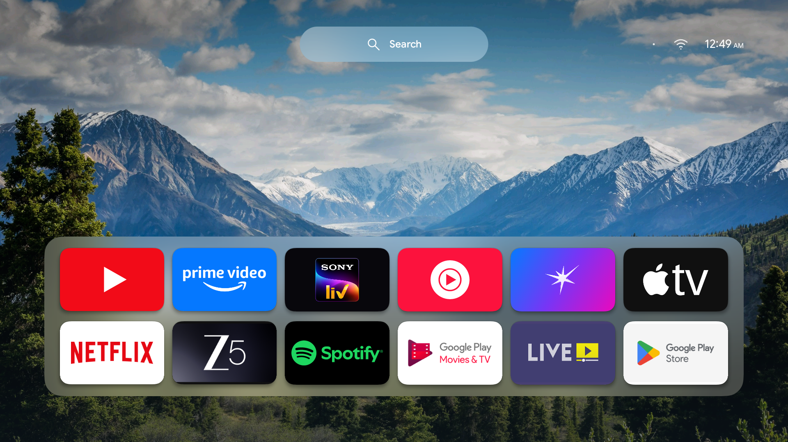

# Mountain TV

A minimal Android TV home screen with twelve app shortcuts, a mountain wallpaper, frosted glass, a pill-shaped Search button, Wi-Fi settings and a clock. Version **0.6.2**.



## Features

- YouTube, Prime Video, Sony LIV, YouTube Music, JioHotstar, Apple TV, Netflix, ZEE5, Spotify, Google Play Movies, Live TV and Google Play Store. Only installed apps appear; no streaming apps are installed automatically.
- Native Java views, fixed card proportions, continuous card corners, smooth focus transitions and shared static Google Sans fonts.
- Cached wallpaper blur on the dock and fully rounded Search control, including on Android 10.
- Google’s existing search opens in typing mode. Google handles voice input, title results, availability and provider launching. Hold Search for voice.
- No ads, recommendation feed, API credentials or companion server. The launcher does not request INTERNET or RECORD_AUDIO permission.
- A small dot beside Wi-Fi opens the original home and pauses the optional Home helper. Reopen Mountain TV from Apps to resume.

## Download and install

The private-testing APK is [MountainTV-0.6.2-debug.apk](dist/MountainTV-0.6.2-debug.apk). Verify it against [SHA256SUMS.txt](dist/SHA256SUMS.txt).

1. Enable developer debugging on the TV and connect with Android platform-tools.
2. Install the APK alongside the original launcher:

   ```sh
   adb install -r dist/MountainTV-0.6.2-debug.apk
   adb shell am start -n com.anubhab.mountaintv/.MainActivity
   ```

3. Choose Mountain TV as Home if the TV supports it. On firmware that forces its stock launcher, enable **Mountain TV Home helper** in **Settings → Accessibility**.
4. Keep the original launcher enabled. Turn off debugging after installation; ordinary use does not require ADB.

The supplied APK is debug-signed for sideload testing. Signing keys are not included. A fresh local build may use a different debug signing key and cannot update an installed build signed with another key without first removing it.

Google search requires the installed, enabled Google TV search app (`com.google.android.katniss`). Search UI, availability results, account access and subscriptions belong to Google and the streaming apps.

## Build

Requires JDK 17, Android SDK platform 34 and build-tools 34.0.0. Set `JAVA_HOME` and `ANDROID_HOME` for your local installations, then:

```sh
cd android
./gradlew --no-daemon testDebugUnitTest lintDebug assembleDebug
```

The included wrapper uses Gradle 8.9 with a pinned distribution checksum. Output: `android/app/build/outputs/apk/debug/app-debug.apk`. Minimum Android version: 8.0 (API 26); compile/target SDK: 34.

## Home helper

The optional Accessibility service redirects the exact stock Home activity when firmware prevents choosing another default. Its package filter is restricted to the selected stock launcher and Google search, so intermediate search transitions can settle before redirection.

It receives window-state metadata only. It does not retrieve screen text, filter remote keys, capture screenshots, perform gestures or transmit accessibility data. Android reports capabilities 0. Switch off the service in Accessibility to stop redirection. The return dot pauses it until Mountain TV is reopened.

## Preview and validation

Serve this folder with any local static server, then open `preview/`. The browser is a visual reference: it cannot launch Android TV apps or send TV commands. See [validation details](docs/VALIDATION.md) for local and device evidence.

Wallpaper rotation is **not implemented** in 0.6.2. A [ten-image candidate list](docs/WALLPAPER-CANDIDATES.md) is awaiting selection; those original image downloads are not bundled here.

## Credits

Inspired by [CleanYourTV](https://github.com/Gathin23/cleanyourtv). The upstream MIT notice is retained in [LICENSE-UPSTREAM](LICENSE-UPSTREAM).

Third-party asset provenance and applicable notices are in [ASSET-CREDITS.md](assets/ASSET-CREDITS.md), [brand-mark credits](assets/brand-marks/CREDITS.md) and [installed-banner credits](assets/installed-banners/CREDITS.md). Google Sans is supplied under the included SIL Open Font License; corner geometry attribution is retained under MIT. App names, logos and publisher artwork remain with their respective owners.
